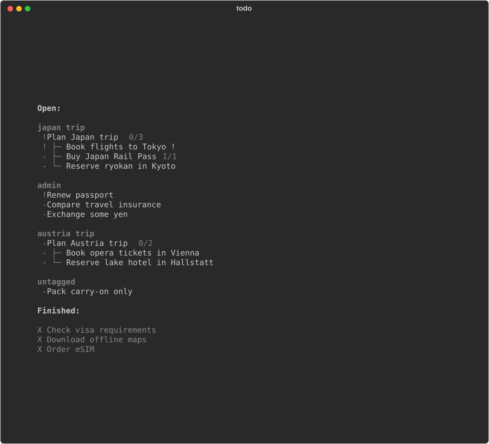

# zktatr



Task management on top of [zk](https://github.com/zk-org/zk). Tasks are zk notes in
`<notebook>/tasks` (notebook is in `$ZK_NOTEBOOK_DIR`).

Needs [uv](https://docs.astral.sh/uv/), zk and [fzf](https://github.com/junegunn/fzf).

## Setup

```sh
make install              # installs `todo` into ~/.local/bin
make install-completion   # zsh completion (oh-my-zsh)
```

## Usage

```sh
todo                              # TUI with all open tasks
todo today                        # TUI with tasks due today + overdue
todo tags                         # tags in use
todo add Fix the build            # add a task
todo add Fix the build @tag1 @tag2 ++   # trailing @tags and + priority (each + = 25)
todo add Fix the build -t tag1 -p 3 -e  # flags; -e opens the editor
todo add Pay rent -d tomorrow           # due date; default is today
todo add Plan Q1 -d "next monday"       # GNU date syntax, quote it if it has spaces
todo add Review PR --link https://github.com/org/repo/pull/1   # attach a link
todo add Review -d "next month"         # also: "+3 days", "friday", 2026-11-20
```

New tasks are due today unless you pass `-d`. `todo` and `todo today` sort the same
way (priority, then title); overdue tasks are marked with `!`. `-d` needs GNU date
(`brew install coreutils` on macOS, gives `gdate`).

TUI keys: `enter` or `/` pick tasks with fzf, `r` refresh, `ctrl+d` quit.

## Note format

Frontmatter fields: `title`, `status` (`open`/`done`), `priority`, `tags`, `depends`
(subtasks).

# References

This project is very much based on 

- [https://github.com/zk-org/zk](https://github.com/zk-org/zk)
- [https://github.com/cstein/pytatr](https://github.com/cstein/pytatr)
- [https://github.com/tsoding/tatr](https://github.com/tsoding/tatr)

